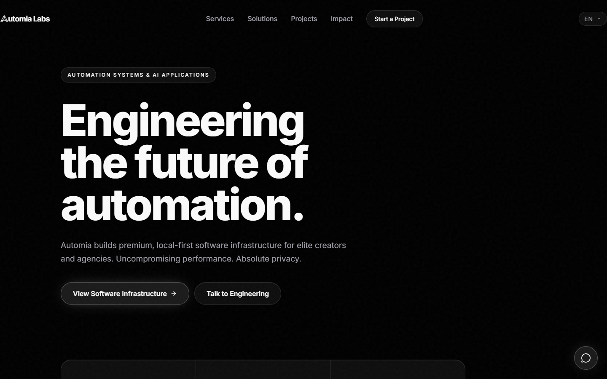
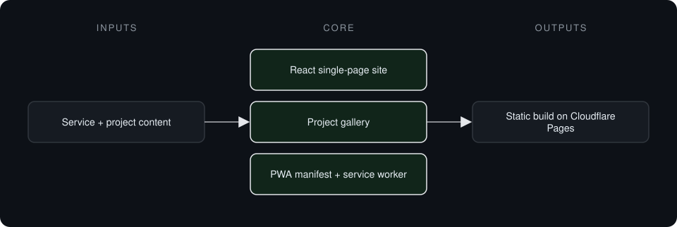
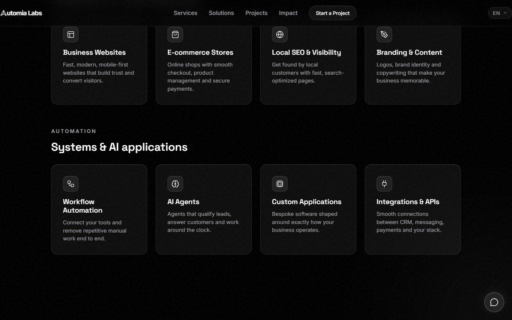
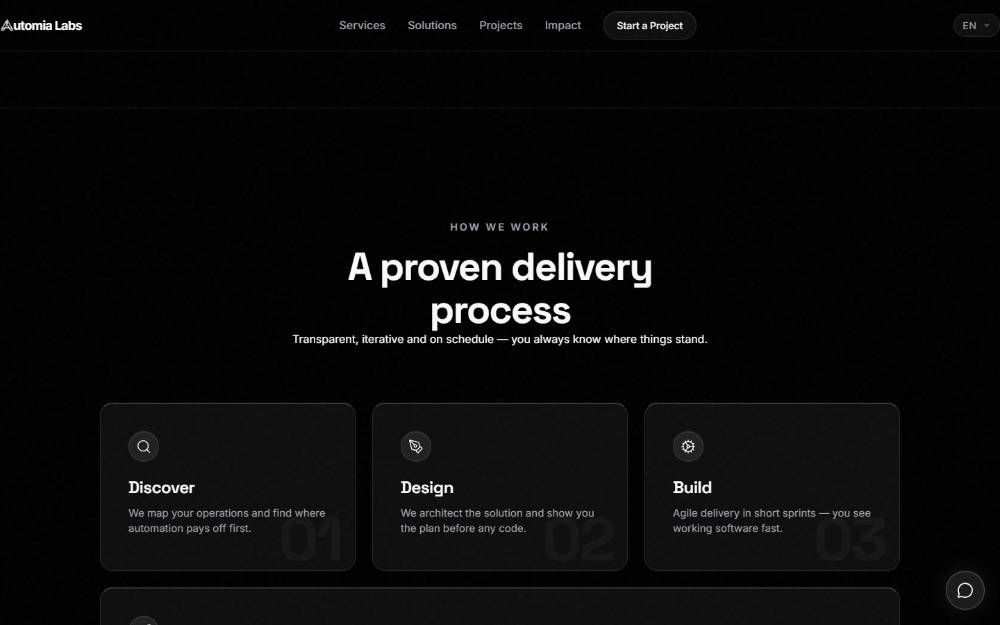

# Automia Website

**Marketing site for Automia, an automation and AI applications studio, with a client project gallery.**

> **This is a proprietary project. Source code is private. This page showcases the system's architecture and results.**

**Case study page:** [https://jryahia.github.io/showcase-automia/](https://jryahia.github.io/showcase-automia/)

## Problem it solves

An automation studio needs a site that explains services clearly and proves delivery through real client work. This site presents the service lines, delivery process and project gallery as a fast installable web app.

## Architecture

1. Content is authored as React components.
2. Vite builds a static bundle.
3. The site deploys to Cloudflare Pages with headers and redirects.
4. It is installable as a PWA.

## Key features

- Service and solution sections
- Client project gallery
- Delivery process section
- Installable PWA
- Static hosting with caching headers

## Tech stack

   

## What it does in practice

- One static site that presents the studio's services and client work.

## Screenshots

**Hero**

**Services and systems**

**Delivery process**

---

Built by [Yahya Jarray](https://github.com/jryahia). Interested in a similar system? [Get in touch](mailto:yahiajarray43@gmail.com).
